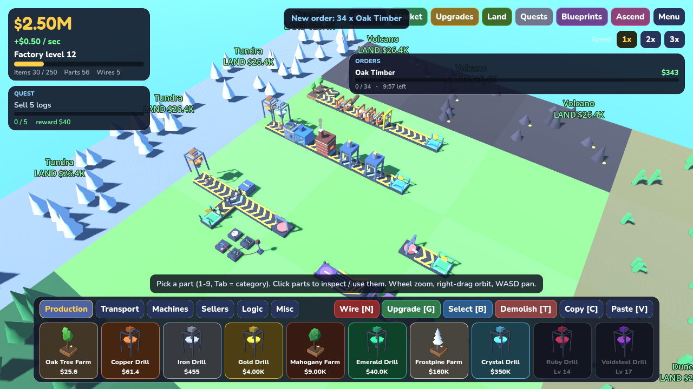

# Factory Islands

A low-poly 3D factory tycoon on floating islands, inspired by the factory side of Roblox *Islands*, built in
**Godot 4.4** (GL Compatibility renderer, Jolt physics). Everything you produce is a real physics object, and
machines act on its actual geometry:

* Tree farms grow a tree that **topples a real log** onto your belt.
* A **rip saw splits a log exactly where its blade meets it**. Shift the blade offset and you get timber, then planks.
* A **chop saw** drops on a timer (or a wire pulse) and cross-cuts whatever is under the blade at that moment.
* A **crusher** really breaks boulders into fragments, and a **sieve grate** lets the small ones fall through its bars.
* A **furnace** heats pieces until they melt into a metal pool and casts ingots. Big boulders don't fit its intake.
* A **hydraulic press** flattens metal: half the height, wider and longer, same volume. Ingot, then plate, then sheet.
* **Wiring**: levers, buttons, timers, item sensors, AND/OR/NOT/XOR, delays and counters drive machines,
  pistons (physical sorters), doors, diverters, teleporters and lamps.



## Play

**Easiest: open in Godot.** Install [Godot 4.4.x](https://godotengine.org/download) (standard build), choose
*Import*, select `project.godot`, then press **F5**.

**Builds:** every push runs GitHub Actions (`.github/workflows/build.yml`). It runs the tests and exports
**Web, Windows and Linux** builds as downloadable artifacts. If you enable GitHub Pages (Settings, then Pages,
source *GitHub Actions*), the browser build is published automatically from the default branch.

## Controls

| | |
|---|---|
| Camera | WASD / arrows pan, Q/E rotate, mouse wheel zoom, right-drag orbit, middle-drag pan, Shift = faster |
| Build | 1-9 pick part, Tab next category, left-click place, drag to paint lines (belts auto-turn), Shift+drag fill area |
| | R rotate, Z / X (or Ctrl+wheel) build layer, right-click / Esc cancel |
| Interact | click a lever/button to use it; click any other part to open the inspector (settings, upgrade, rotate, wire, demolish) |
| Tools | N wire, G upgrade (Ctrl = max, Shift+drag = area), B select, C copy, V paste, T / Delete demolish |
| Panels | O orders, M market, U upgrades, L land, J quests, F blueprints, P ascension, H help, Esc menu |

## Gameplay loop

1. **Produce**: tree farms (logs) and drills (ore boulders, gem geodes), with a new material in each biome.
2. **Process**: Value = material price × volume × form bonus × quality × market demand.
   * Wood: Log (×1), Rip Saw, Timber (×1.4), offset rips or Gang Saw, **Plank** (×2.6)
   * Ore: Boulder, Crusher, Chunks, (Washer +purity), Furnace, **Ingot** (×3), Press, **Plate** (×4.2), Press, **Sheet** (×5.5)
   * Gems: Geode, Crusher frees pure **Shards** (×1.8), Polisher, **Polished Gem** (×4.5 × quality)
   * Crate Packer: N items become one crate worth +30%, counted once by the market.
3. **Sell** on trade pads. Prices for each product drop as you sell it and recover over time, so diversify.
4. **Grow**: buy blueprint unlocks (gated by factory level), global upgrades, per-part levels, land plots
   (each biome adds materials), fill rotating **orders**, finish quests, and **Ascend** for permanent star bonuses.
   Offline earnings and autosave included.
5. **Scale**: copy/paste whole factories, including settings and wiring, and save up to 8 blueprints. Build
   vertically with ramps and platforms, and move items across the island with teleporters.

See [`docs/DESIGN.md`](docs/DESIGN.md) for the full design: the item model, the cutting algorithm and the wiring semantics.

## Project layout

```
scripts/
  Game.gd        autoload: economy, unlocks, upgrades, land, market & orders, quests, prestige, save/load
  FX.gd          autoload: procedural sound effects + music, floating text, particle bursts
  Defs.gd        all data: materials, forms, parts, upgrades, quests
  World.gd       main scene: grid, item pool, cut/crush/press geometry ops, wiring network, save glue
  Item.gd        physical item (material, shape, size, purity, heat) and its value
  Part.gd        base class for placed parts (batched static visuals, animated pieces, signals, levels)
  parts/*.gd     one script per machine kind
  Builder.gd     placing, painting, demolish, upgrade, wiring, blueprints, interaction
  Hud.gd         all UI (built in code), IconRenderer.gd renders part thumbnails from the real models
  Batcher.gd     MultiMesh batching so huge factories stay cheap to draw
  Terrain.gd     floating island plots, Wires.gd cable rendering, Meshes.gd procedural low-poly meshes
tests/           headless physics/logic tests, input-driven interaction test, pacing bot, screenshot scenes
assets/fonts/    Nunito + Fredoka (SIL Open Font License)
```

All models, sounds and music are generated procedurally in code. The only external assets are the two OFL fonts.

## Tests

```bash
godot --headless --import --path .
godot --headless --path . res://tests/LogicTest.tscn                  # economy, save/load, cutting & pressing math
godot --headless --path . res://tests/SimTest.tscn --fixed-fps 60     # every production chain, simulated with physics
xvfb-run -a godot --path . res://tests/Interact.tscn --rendering-driver opengl3   # real mouse/keyboard input
godot --headless --path . res://tests/Bot.tscn --fixed-fps 60 -- 30   # pacing bot plays 30 game-minutes
xvfb-run -a godot --path . res://tests/Shot.tscn --rendering-driver opengl3       # screenshots into tests/shots
```
